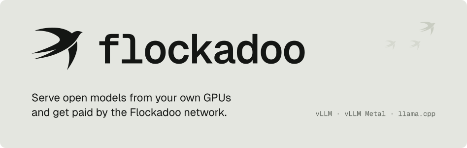

<div align="center">

<picture>
  <source media="(prefers-color-scheme: dark)" srcset=".github/assets/banner-dark.svg">
  
</picture>

<br>

[](https://github.com/Flockadoo/flockadoo/releases/latest)
[](https://github.com/Flockadoo/flockadoo/actions/workflows/ci.yml)
[](LICENSE)
[](go.mod)
[](SECURITY.md)
[](https://hub.docker.com/r/flockadoo/flockadoo)

[Quick start](#1️⃣-check-your-machine) · [Docker](#-docker) · [Configuration](#️-configuration) · [REST API](#-rest-api) · [Docs](https://docs.flockadoo.ai) · [Security](SECURITY.md)

</div>

---

## 🧭 How it works

Flockadoo sends inference requests to your machine. This client runs next to your engine (vLLM, vLLM Metal or llama.cpp), dials out to Flockadoo, passes each request to the engine and copies the answer back. It needs no open port. You set your prices on [flockadoo.ai](https://www.flockadoo.ai).


## 1️⃣ Check your machine

| | 🐧 Linux | 🍎 macOS | 🪟 Windows |
|---|---|---|---|
| **Engine** | vLLM | vLLM Metal or llama.cpp | llama.cpp (GGUF) |
| **Machine** | amd64 or arm64, 32 GB RAM | Apple Silicon, 48 GB unified memory | 64-bit, 32 GB RAM |
| **GPU** | NVIDIA, 24 GB VRAM (for example RTX 3090 or 4090) | built in | NVIDIA, 24 GB VRAM |
| **Software** | NVIDIA driver; uv (setup installs it) | macOS 13 Ventura or later | NVIDIA driver |
| **GPU monitoring** | full, via `nvidia-smi` | basic, via `system_profiler` | via `nvidia-smi` |

> [!NOTE]
> No CUDA toolkit is needed, and no system Python: setup installs uv to `~/.local/bin`, and uv downloads its own Python 3.12 for vLLM. Intel Macs are not supported.

🔎 Once installed, `flockadoo compatibility` lists the models this machine can serve. See [Model compatibility check](#-model-compatibility-check).


## 2️⃣ Get your API key

Sign up at [flockadoo.ai](https://www.flockadoo.ai) and create a flock. Copy the API key from the flock's **Settings** ([how](https://docs.flockadoo.ai/requirements/signup)).


## 3️⃣ Install

#### 🐧 Linux and 🍎 macOS

```bash
curl -fsSL https://raw.githubusercontent.com/flockadoo/flockadoo/main/scripts/install.sh | bash
```

#### 🪟 Windows (PowerShell)

```powershell
irm https://raw.githubusercontent.com/flockadoo/flockadoo/main/scripts/windows-install.ps1 | iex
```

> [!TIP]
> The wizard asks for your API key, then the engine and model. A Team Flock API key skips that and uses the model chosen for the flock; a join code installs vLLM and confirms the flock at the end. Run the wizard again any time with `flockadoo setup`.

Guides: [macOS](https://docs.flockadoo.ai/introduction/setup-mac) · [Windows](https://docs.flockadoo.ai/introduction/setup-windows). 🤖 Installing from a script, CI or Docker? See [Install without the wizard](#-install-without-the-wizard).


## 4️⃣ Start serving

| Command | What it does |
|---|---|
| `flockadoo` | Starts the client |
| `flockadoo --config ~/.config/flockadoo/config.yaml` | Starts with a specific config file |
| `flockadoo --console` | Windows: the terminal view instead of the tray |
| `flockadoo setup` | Runs the wizard again |
| `flockadoo update` | Installs the latest release |
| `flockadoo compatibility` | Lists the models this machine can serve |

> [!NOTE]
> On Windows, `flockadoo` runs in the notification area. The prompt waits until the local dashboard is up, then returns; closing PowerShell does not stop it. Right-click the tray icon → **Open dashboard** for live status in the browser, or **Quit** to stop.


## 5️⃣ Set your prices

> [!IMPORTANT]
> On its first start the client publishes your models with default prices. Set your own on [flockadoo.ai](https://www.flockadoo.ai).

---

## 📚 Reference

- 💫 [Install without the wizard](#-install-without-the-wizard): scripts, CI and Docker
- 🧪 [Model compatibility check](#-model-compatibility-check): statuses and options
- 🐳 [Docker](#-docker): run, Compose and build from source
- 🔌 [REST API](#-rest-api): the local dashboard and JSON endpoints
- ⚙️ [Configuration](#️-configuration): `config.yaml` and log files


### 💫 Install without the wizard

For scripts, CI and Docker, where nobody is there to answer prompts. You run the inference engine yourself and tell the installer which model it serves.

```bash
export FLOCKADOO_SKIP_SETUP=1
export PROVIDER_API_KEY="your-provider-api-key"
export PROVIDER_TYPE="vllm"                       # vllm, vllm-metal or llama_cpp
export PROVIDER_MODEL="Qwen/Qwen2.5-7B-Instruct"  # the model your engine serves
export LLM_URL="http://127.0.0.1:8000"
export SERVER_PORT="8080"

curl -fsSL https://raw.githubusercontent.com/flockadoo/flockadoo/main/scripts/install.sh | bash
```

`PROVIDER_MODEL` is required. It must be an [approved model](https://docs.flockadoo.ai/provider-client/approved-models) for your engine, and your engine must serve it under that exact name. The install stops with an error if it is not. With a Team Flock key or a join code, leave `PROVIDER_MODEL` unset: the flock's model is used.

> [!NOTE]
> The client does not install or start the engine in this mode. To change other defaults, see [overriding defaults](https://docs.flockadoo.ai/provider-client/configuration#overriding-defaults).


### 🧪 Model compatibility check

Works on Linux and Windows with NVIDIA (`nvidia-smi`) and on macOS (Apple Silicon unified memory via `sysctl` / `system_profiler`). It does not start the client and does not need an API key.

```bash
flockadoo compatibility
flockadoo compatibility --provider-type vllm
flockadoo compatibility --json
flockadoo compatibility --catalog-url https://core.flockadoo.ai
flockadoo compatibility --offline-catalog ./approved-models.json
```

| Status | Meaning |
|---|---|
| `runs_well` | The model needs under 50% of usable memory |
| `fits` | Under 75% |
| `tight` | Under 95% |
| `too_large` | 95% or more |
| `unknown` | The catalog has no size for the model, or usable memory could not be read |

Scoring uses the catalog's `min_size_bytes` plus a conservative runtime overhead (higher for vLLM). Apple Silicon uses a fraction of unified memory; Linux scores against the largest single GPU's VRAM. The catalog's `engines` field filters the list further: on Windows, `compatibility` lists `llama_cpp` (GGUF) models; untagged vLLM models stay on Linux and macOS.


### 🐳 Docker

The image is [`flockadoo/flockadoo`](https://hub.docker.com/r/flockadoo/flockadoo) on Docker Hub. The container always [installs without the wizard](#-install-without-the-wizard), so `PROVIDER_MODEL` is required.

- If the engine runs on the Docker host, bind it to `0.0.0.0` and set `LLM_URL` to `http://host.docker.internal:8000` (vLLM) or `:8081` (llama.cpp).
- The client dials out to Flockadoo, so it needs **no** published port. To open the local dashboard from the host, set `server.host` to `0.0.0.0` in the container's config and publish the port (for example `-p 127.0.0.1:8080:8080`).

> [!WARNING]
> On a stop, the client finishes the requests it is serving, for up to 60 seconds. Docker's default stop timeout is 10 seconds, so the examples give it 75; with less, Docker kills the client mid-answer.

```bash
docker run -d \
  --name flockadoo \
  --stop-timeout 75 \
  -e PROVIDER_API_KEY="your-key" \
  -e PROVIDER_TYPE="vllm" \
  -e PROVIDER_MODEL="Qwen/Qwen2.5-7B-Instruct" \
  -e LLM_URL="http://host.docker.internal:8000" \
  flockadoo/flockadoo:latest
```

#### Docker Compose

```yaml
services:
  flockadoo:
    image: flockadoo/flockadoo:latest
    environment:
      - PROVIDER_API_KEY=your-key
      - PROVIDER_TYPE=vllm
      - PROVIDER_MODEL=Qwen/Qwen2.5-7B-Instruct
      - LLM_URL=http://host.docker.internal:8000
    stop_grace_period: 75s
    restart: unless-stopped
```

#### Build from source

```bash
docker build -t flockadoo .
docker run -d \
  --name flockadoo \
  --stop-timeout 75 \
  -e PROVIDER_API_KEY="your-key" \
  -e PROVIDER_MODEL="Qwen/Qwen2.5-7B-Instruct" \
  -e LLM_URL="http://host.docker.internal:8000" \
  flockadoo
```


### 🔌 REST API

Loopback only; not reachable through the connection to Flockadoo.

| Endpoint | Returns |
|---|---|
| `GET /` | The local status dashboard (the same information as the terminal view), refreshing in the browser |
| `GET /api/status` | A JSON snapshot of the dashboard: session, models, GPU, recent requests |
| `GET /api/health` | The provider's health, GPU information (if available) and models |
| `GET /api/busy` | Whether the GPU is busy (`TRUE` or `FALSE`) |


### ⚙️ Configuration

The client reads `~/.config/flockadoo/config.yaml`. See [`config.yaml.example`](config.yaml.example) for every setting.

| Setting | Default | What it does |
|---|---|---|
| `server.port` | `8080` | Port of the local dashboard and REST API |
| `server.host` | `127.0.0.1` | Address they listen on |
| `provider.api_key` | | Your provider API key |
| `provider.url` | `https://core.flockadoo.ai` | The Flockadoo platform |
| `provider.provider_type` | | `vllm` for vLLM and vLLM Metal, `llama_cpp` for llama.cpp |
| `provider.engine` | `vllm` | The local engine: `vllm`, `vllm-metal` or `llama_cpp` |
| `provider.llm_url` | `http://127.0.0.1:8000` | The local engine's URL (llama.cpp: `http://127.0.0.1:8081`) |
| `logging.level` | `info` | `debug`, `info`, `warn` or `error` |
| `logging.log_dir` | `~/.local/state/flockadoo/log` | Where logs are stored |
| `logging.max_size` | `100` | Megabytes before a log file is rotated |
| `logging.max_backups` | `5` | Old log files kept |
| `logging.max_age` | `30` | Days old log files are kept |

Under `log_dir`, **`flockadoo.log`** holds every level and **`error.log`** only errors.
